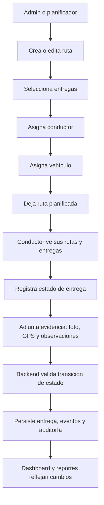
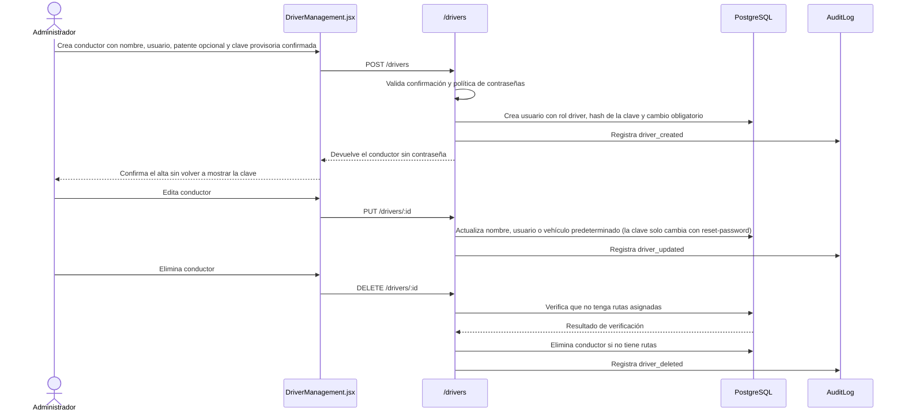
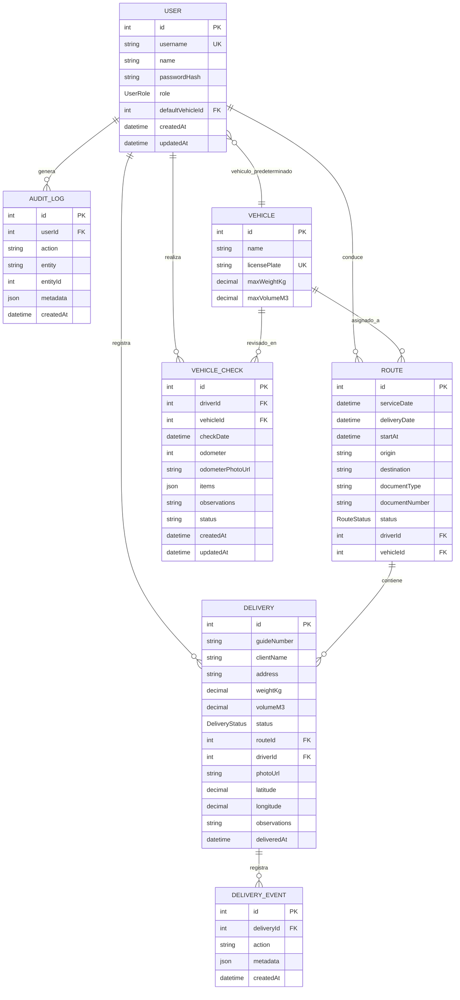
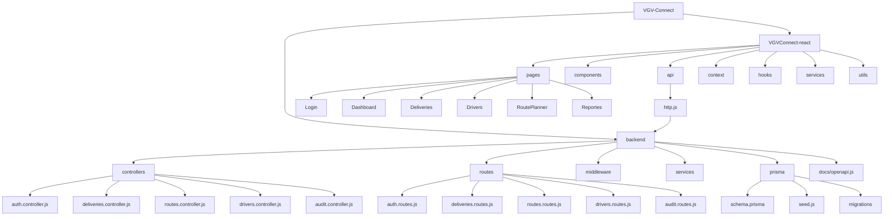

# Diagramas de flujos de trabajo y módulos

Este documento resume los flujos principales de VGV Connect y la relación entre módulos de frontend, backend y base de datos.

## Vista general de módulos

```mermaid
flowchart LR
  Usuario[Usuarios del sistema] --> Frontend[Frontend React + Vite]

  subgraph FrontendModules[Frontend]
    Login[Login]
    Layout[Layout, Navbar y Sidebar]
    Home[Home]
    Dashboard[Dashboard operativo]
    Entregas[Administración de entregas]
    Rutas[Planificador de rutas]
    Conductores[Conductores]
    Reportes[Reportes]
    Conductor[Panel de conductor]
    CheckVehiculo[Check vehículo]
  end

  Frontend --> FrontendModules
  FrontendModules --> ApiClient[API clients Axios]

  ApiClient --> Backend[Backend Express]

  subgraph BackendModules[Backend]
    AuthAPI[/auth]
    DeliveriesAPI[/deliveries]
    RoutesAPI[/routes]
    DriversAPI[/drivers]
    AuditAPI[/audit]
    DocsAPI[/api-docs y /openapi.json]
    Middleware[Auth middleware y roles]
    Services[Servicios: auditoría, estados, geocoding, Google Drive]
  end

  Backend --> Middleware
  Middleware --> BackendModules
  BackendModules --> Prisma[Prisma Client]
  Prisma --> Postgres[(PostgreSQL)]
```

## Acceso por rol

```mermaid
flowchart TD
  Login[Inicio de sesión] --> Token[JWT + usuario autenticado]
  Token --> RoleHome{Rol}

  RoleHome -->|admin| AdminHome[/dashboard]
  RoleHome -->|route_planner| PlannerHome[/rutas]
  RoleHome -->|billing| BillingHome[/reportes]
  RoleHome -->|driver| DriverHome[/conductor]

  AdminHome --> AdminModules[Dashboard, entregas, rutas, conductores y reportes]
  PlannerHome --> PlannerModules[Dashboard, rutas, conductores y entregas]
  BillingHome --> BillingModules[Dashboard, reportes y entregas]
  DriverHome --> DriverModules[Mis entregas, registro de entrega y check vehículo]
```

## Flujo operativo principal



## Flujo de administración de conductores



## Flujo de ruta y entregas

```mermaid
sequenceDiagram
  actor Planner as Admin / Planificador
  participant RouteUI as RoutePlanner.jsx
  participant RoutesAPI as /routes
  participant DeliveriesAPI as /deliveries
  participant Audit as AuditLog
  participant Status as status-transitions.service
  participant DB as PostgreSQL

  Planner->>RouteUI: Define origen, destino, fecha, documento, conductor y vehículo
  RouteUI->>RoutesAPI: Crea o actualiza ruta
  RoutesAPI->>DB: Valida conductor, vehículo y paradas; actualiza Route y Delivery en una transacción
  RoutesAPI->>Audit: Registra route_reassigned si cambia el conductor

  actor Driver as Conductor
  Driver->>RouteUI: Abre entrega asignada
  RouteUI->>DeliveriesAPI: Actualiza estado y evidencia
  DeliveriesAPI->>Status: Valida cambio de estado
  Status-->>DeliveriesAPI: Transición válida
  DeliveriesAPI->>DB: Actualiza Delivery y crea DeliveryEvent
```

### Consistencia de asignaciones e historial

- `Route.driverId` es la fuente de verdad para las entregas no terminales (`pending`, `planned`, `in_progress`). Al reasignar una ruta, esas entregas cambian al nuevo conductor en la misma transacción; si no cambia el conductor, no se reescriben.
- Las paradas creadas con `POST /routes` comienzan en estado `pending`; la planificación no puede crear una entrega con resultado final.
- Las entregas terminales (`completed`, `rejected`, `not_found`) conservan el conductor que las ejecutó y no se pueden editar ni quitar desde `PUT /routes/:id`; sus cambios pertenecen al flujo operacional de entregas.
- `toRemove` solo libera entregas no terminales, estableciendo `routeId` y `driverId` en `null`. El intento de quitar una terminal responde HTTP 400 sin escrituras.
- La eliminación física de una ruta con entregas terminales se rechaza con HTTP 409. Sin terminales, las entregas se liberan y la ruta se elimina en una transacción.
- Las reasignaciones y eliminaciones se auditan dentro de la transacción, por lo que un fallo no deja una entrada de auditoría de una operación no confirmada.

### Check preoperacional y autorización de vehículos

- El conductor se identifica desde el JWT; los `driverId` del payload no cambian su identidad ni el alcance de sus checks.
- Un conductor puede inspeccionar su vehículo predeterminado o el de una ruta `draft`, `planned` o `in_progress` cuya fecha de servicio no sea histórica. Las rutas completadas e históricas no autorizan un vehículo.
- Los administradores pueden consultar y guardar checks para conductores existentes con rol `driver`; las operaciones registran el conductor afectado en la auditoría.
- La foto debe cargarse mediante el servicio de imágenes existente. No se aceptan URLs arbitrarias; al actualizar un check se puede conservar únicamente la URL ya almacenada para ese mismo check.
- Si no hay vehículo autorizado, la interfaz informa que el conductor debe contactar a administración y no permite enviar un check.

## Modelo de datos principal



## Mapa de módulos por carpeta



## Responsabilidades por módulo

| Módulo | Responsabilidad principal |
| --- | --- |
| Login/Auth | Autenticación, persistencia del token y redirección por rol. |
| Dashboard | Lectura de KPIs, tabla, filtros, gráficos y mapa operativo. |
| Entregas | Gestión y seguimiento de entregas, estados y evidencia. |
| Rutas | Creación, planificación y asignación de rutas a conductor/vehículo. |
| Conductores | Resumen operativo y mantención de conductores. |
| Reportes | Métricas históricas y rendimiento por período/conductor. |
| API Express | Expone endpoints, aplica CORS, auth y reglas de negocio. |
| Prisma/PostgreSQL | Persistencia de usuarios, vehículos, rutas, entregas, eventos y auditoría. |
| Servicios backend | Auditoría, transiciones de estado, geocoding y almacenamiento de evidencias. |
